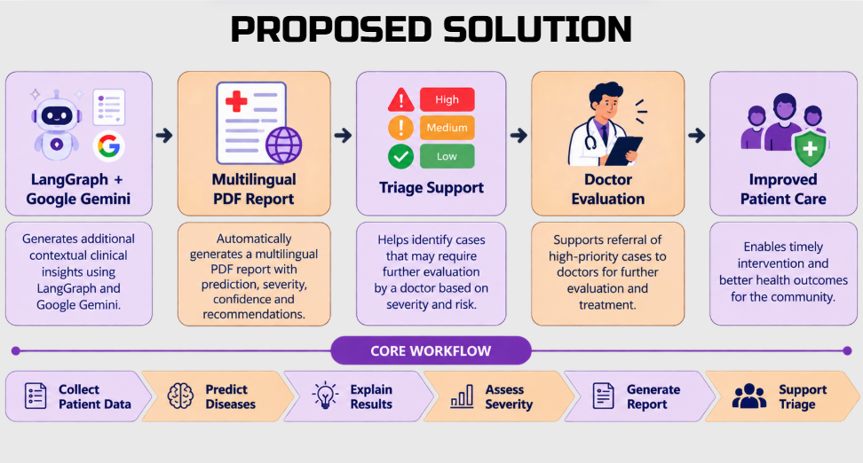
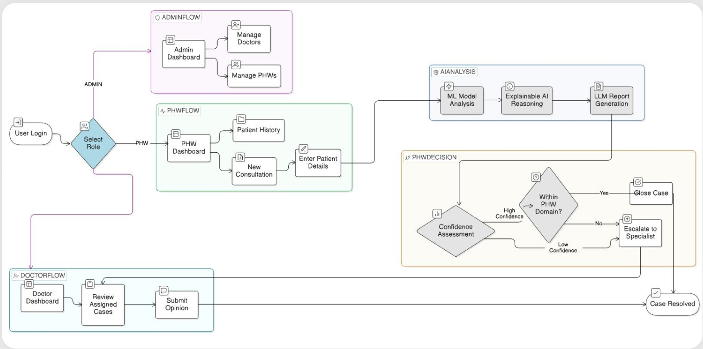
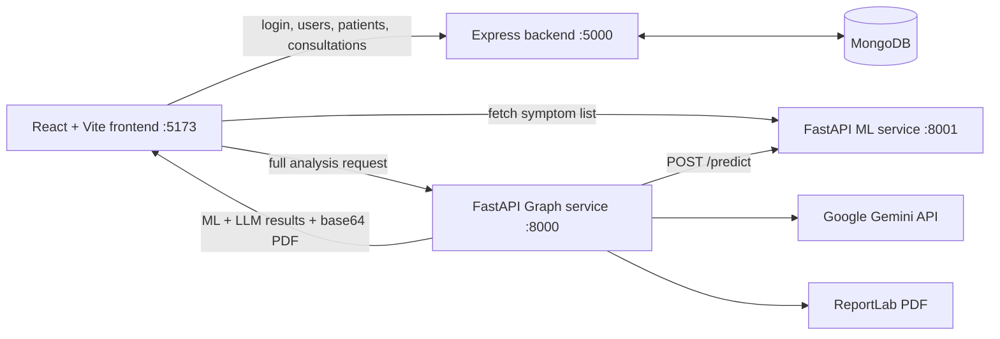

# Clinexa

Clinexa is a role-based healthcare decision-support application for primary healthcare workers. It combines patient and consultation management with a machine-learning symptom prediction service, explainable AI output, optional Gemini-generated clinical context, and PDF reports.

> **Clinical safety:** Clinexa provides decision support only. Its predictions and generated text are not a diagnosis and must not replace a qualified clinician's judgement.

## What the application does

- **Admin:** creates and manages healthcare workers and doctors.
- **Healthcare worker (PHW):** records patients, starts consultations, reviews analysis, and can refer a case to a doctor.
- **Doctor:** reviews assigned consultations and submits a second opinion.
- **ML service:** predicts likely conditions from recognized symptoms and returns confidence, top predictions, and LIME feature explanations.
- **Graph service:** coordinates the ML result, Gemini-generated summary, and PDF report.

The dashboard interface includes English, Hindi, and Marathi translations. The current PDF template has fixed English labels; localized PDF output may need additional implementation.

## Project workflow

### Patient assessment and AI analysis



1. A healthcare worker enters patient details and reported symptoms.
2. The ML service matches symptoms to its trained feature set and runs the Random Forest model.
3. The service returns a primary prediction, top predictions, confidence, and a LIME explanation of influential features. Unknown symptoms are reported separately.
4. The Graph service sends the structured ML result to Google Gemini for a clinical-context summary, recommendations, and a severity assessment.
5. The Graph service combines the results into a PDF report and returns the analysis and PDF to the frontend.
6. The healthcare worker reviews the result and decides whether to continue care or refer the case. AI output should always be reviewed by a qualified professional.

### Role and case-management flow



The admin portal manages doctor and healthcare-worker accounts. Healthcare workers manage patient consultations; cases can be escalated for a doctor's review and second opinion before being resolved.

## How the services communicate



The frontend calls the ML service directly to fetch available symptoms. Full analysis is sent to the Graph service, which calls the ML prediction endpoint and then Gemini before generating the report. The Express backend handles authentication and application data stored in MongoDB.

## Requirements

- Node.js and npm
- Python 3.11 recommended
- MongoDB running locally, or a MongoDB Atlas connection string
- A Google Gemini API key for the LLM analysis step

The ML model artifacts are expected under `ML_Model/model/`:

```text
disease_model.pkl
label_encoder.pkl
symptom_columns.pkl
X_train.pkl
```

## Local setup (Windows PowerShell)

Run commands from the project root unless a step says otherwise. Keep each service running in its own terminal.

### 1. Configure MongoDB and the backend

Start your local MongoDB service, or prepare a MongoDB Atlas connection string. Then:

```powershell
cd Backend
Copy-Item .env.example .env
```

Edit `Backend\.env` and set at least:

```env
PORT=5000
DB_URL=mongodb://127.0.0.1:27017/clinexa
JWT_SECRET=<a-long-random-secret>
JWT_EXPIRY=1d
NODE_ENV=Development
```

For Atlas, replace `DB_URL` with your Atlas URI. `OTPEMAIL` and `OTPPASSWORD` are needed only for email/OTP functionality. The `CLOUDINARY_*` values are needed for features that upload files or reports. Do not commit `.env` files or put real credentials in this README.

Install and run the backend:

```powershell
npm ci
npm run dev
```

The backend listens on `http://127.0.0.1:5000`. It must connect to MongoDB before it starts accepting requests.

### 2. Configure and install Python services

Open another terminal at the project root:

```powershell
python -m venv .venv
.\.venv\Scripts\Activate.ps1
python -m pip install --upgrade pip
python -m pip install -r graph\requirements.txt
```

The Graph requirements file includes the dependencies used by both Python services. If PowerShell blocks virtual-environment activation, run this in that terminal and try activation again:

```powershell
Set-ExecutionPolicy -Scope Process -ExecutionPolicy Bypass
```

### 3. Configure the Graph / Gemini service

From the project root, open another terminal:

```powershell
Copy-Item graph\.env.example graph\.env
```

Edit `graph\.env`:

```env
GEMINI_API_KEY=<your-Gemini-API-key>
MODEL_NAME=gemini-3.8-flash
ML_API_URL=http://127.0.0.1:8001
```

The Graph API can start without a Gemini key, but full analysis will fail until a valid key and available model are configured. Provider rate limits or temporary outages can also interrupt Gemini requests.

### 4. Start the ML service

Open a new terminal at the project root:

```powershell
cd ML_Model
..\.venv\Scripts\python.exe -m uvicorn app:app --host 127.0.0.1 --port 8001
```

Alternatively, activate `.venv` first and run:

```powershell
python -m uvicorn app:app --host 127.0.0.1 --port 8001
```

### 5. Start the Graph service

Open a new terminal at the project root:

```powershell
cd graph
..\.venv\Scripts\python.exe -m uvicorn server:app --host 127.0.0.1 --port 8000
```

If the virtual environment is activated in that terminal, run:

```powershell
python -m uvicorn server:app --host 127.0.0.1 --port 8000
```

### 6. Configure and start the frontend

Open a new terminal at the project root:

```powershell
cd Frontend
Copy-Item .env.example .env
npm ci
npm run dev -- --host 127.0.0.1 --port 5173 --strictPort
```

Open **http://127.0.0.1:5173**. The first admin account can be registered through the app's registration page; the admin can then add worker and doctor accounts.

## Service URLs and quick checks

| Service | URL | Purpose |
|---|---|---|
| Frontend | `http://127.0.0.1:5173` | Clinexa web application |
| Express backend | `http://127.0.0.1:5000` | Authentication and application APIs |
| ML API | `http://127.0.0.1:8001` | Symptoms and disease prediction |
| Graph API | `http://127.0.0.1:8000` | End-to-end analysis and PDF generation |

FastAPI documentation is available at `http://127.0.0.1:8001/docs` and `http://127.0.0.1:8000/docs`.

## Common startup issues

- **MongoDB URI or connection error:** check that `Backend\.env` has a valid `DB_URL` beginning with `mongodb://` or `mongodb+srv://`, and that the database is reachable.
- **401 Unauthorized:** sign in with the correct role. Protected API endpoints require the login token; a stored user record alone does not authenticate requests.
- **Gemini key/model error:** verify `GEMINI_API_KEY` and `MODEL_NAME` in `graph\.env`. A provider `503` can be temporary; retry later.
- **ML model artifact missing:** verify the four `.pkl` files listed above are in `ML_Model\model\`.
- **Port already in use:** stop the process using the port or choose another port and update the corresponding frontend environment URL and backend CORS origin.
- **Scikit-learn version warning:** the model was serialized with a particular scikit-learn version. A version mismatch may warn during loading; use the training version when available.

## Dataset and implementation notes

- Dataset reference: [Disease Prediction using Machine Learning (Kaggle)](https://www.kaggle.com/datasets/kaushil268/disease-prediction-using-machine-learning)
- ML API source: `ML_Model/`
- Graph orchestration, Gemini integration, and PDF generation: `graph/`
- Express API and MongoDB models: `Backend/`
- React dashboard: `Frontend/`

Predictions and generated recommendations are informational decision support, not medical advice. Confirm findings with a qualified healthcare professional.
